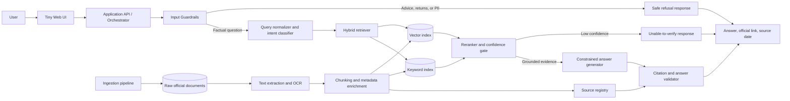
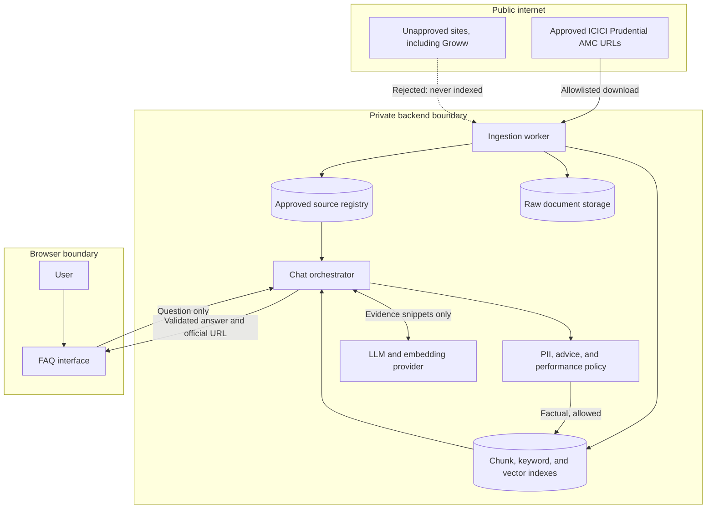
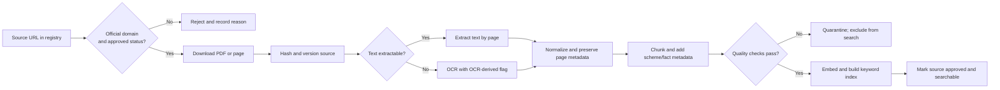
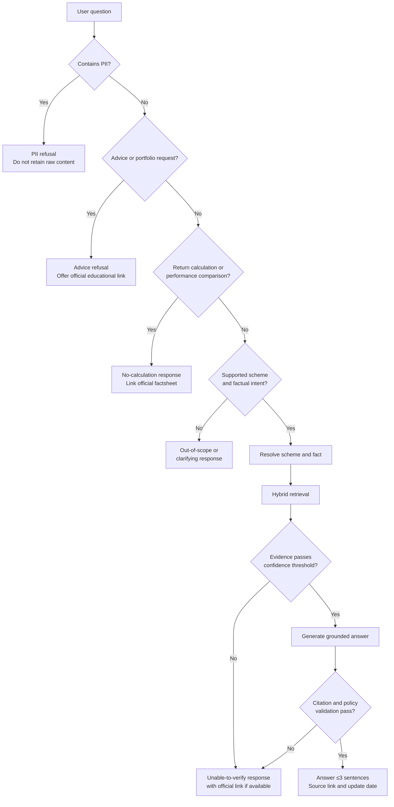
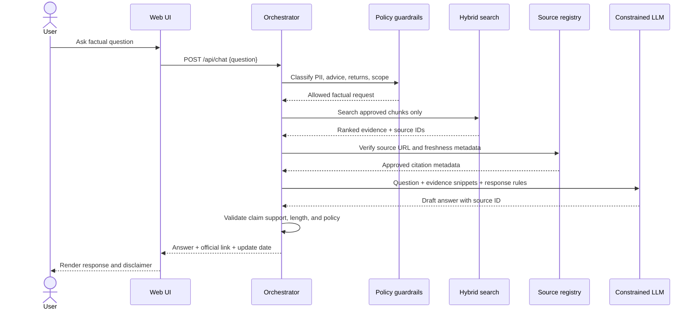
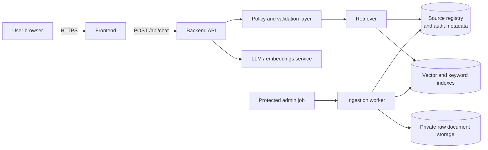

# Architecture: ICICI Prudential Facts-Only RAG Assistant

## 1. Purpose and Scope

This architecture implements the requirements in [problemStatement.md](problemStatement.md): a small retrieval-augmented generation (RAG) assistant for five ICICI Prudential mutual-fund schemes. It answers only factual, source-backed questions from the approved corpus and declines investment-advice, performance-comparison, and PII-related requests.

The initial approved corpus contains 15 official ICICI Prudential AMC documents: a KIM, SID, and factsheet for each scheme. Groww URLs are reference-only and must never enter the retrieval index or be used in citations.

## 2. Design Principles

- **Official-source grounding:** Only approved ICICI Prudential AMC, SEBI, and AMFI pages may be retrieved or cited.
- **Citation-first answers:** A substantive factual answer is returned only when the system can attach a supporting source URL.
- **Safety before retrieval:** Requests for advice, returns comparisons, and PII are handled before the RAG pipeline.
- **Small, inspectable corpus:** Documents, extracted text, chunks, metadata, and citations are versioned and auditable.
- **Concise output:** Answers contain no more than three sentences and show the source-update date.

## 3. High-Level Architecture



## 4. Logical Components

### Component and Trust Boundaries



This separates public source acquisition, private processing, and the browser. In particular, unapproved URLs and account data do not cross into the RAG corpus or model prompt.

| Component | Responsibility | Key rule |
| --- | --- | --- |
| Web UI | Collect a question, show examples, disclaimer, answer, and source link. | Never request or display PII. |
| API / Orchestrator | Coordinates guardrails, retrieval, generation, validation, logging, and error handling. | Stateless request handling where possible. |
| Input guardrails | Detect PII, investment advice, and performance-return comparison requests. | Stop disallowed requests before retrieval. |
| Query understanding | Identifies scheme, requested fact, and document type likely to contain it. | Resolve aliases such as “large and mid cap” and “top 100”. |
| Retriever | Finds the most relevant official chunks through semantic and keyword search. | Searches only approved source IDs. |
| Reranker / confidence gate | Scores retrieved evidence and decides whether it is sufficient to answer. | No answer when evidence is weak or contradictory. |
| Answer generator | Produces a brief, factual response strictly grounded in retrieved chunks. | No recommendations, calculations, or unsupported claims. |
| Citation validator | Confirms the cited URL comes from the source registry and supports the response. | Return a link for every factual answer. |
| Ingestion pipeline | Downloads, extracts, chunks, validates, and indexes official documents. | Reject Groww and other unapproved domains. |
| Source registry | Stores source metadata, version, provenance, status, and index references. | Single source of truth for approval and citations. |

## 5. Data Model

Use a relational database or versioned JSON/CSV files for the source registry and a vector store for embeddings. The initial prototype can use SQLite plus a local vector index; production can use PostgreSQL plus a managed vector database.

### Source Registry

| Field | Description |
| --- | --- |
| `source_id` | Stable internal identifier, for example `icici-large-cap-kim-2026-01`. |
| `scheme_id` | Canonical scheme identifier. |
| `scheme_name` | Human-readable scheme name. |
| `document_type` | `KIM`, `SID`, `FACTSHEET`, `SEBI_GUIDE`, or `AMFI_GUIDE`. |
| `official_url` | Original public document URL used for citation. |
| `approved_domain` | Domain allowlist match, such as `icicipruamc.com`. |
| `published_date` | Date shown in the document, if available. |
| `retrieved_at` | Date and time the document was fetched. |
| `content_hash` | SHA-256 hash used to detect source changes. |
| `status` | `approved`, `superseded`, `failed`, or `blocked`. |

### Chunk Record

| Field | Description |
| --- | --- |
| `chunk_id` | Stable chunk identifier. |
| `source_id` | Source-registry foreign key. |
| `text` | Extracted, normalized chunk text. |
| `page_number` | PDF page containing the evidence. |
| `section_title` | Extracted heading when available. |
| `scheme_id` | Canonical scheme identifier for filtering. |
| `fact_tags` | Tags such as `expense_ratio`, `exit_load`, `minimum_sip`, `benchmark`, or `riskometer`. |
| `embedding` | Vector representation for semantic retrieval. |
| `source_updated_date` | Best available document update date exposed in answers. |

### Approved Scheme IDs

| `scheme_id` | Scheme |
| --- | --- |
| `icici_silver_etf_fof` | ICICI Prudential Silver ETF FoF |
| `icici_large_cap` | ICICI Prudential Large Cap Fund |
| `icici_large_mid_cap` | ICICI Prudential Large & Mid Cap Fund |
| `icici_flexicap` | ICICI Prudential Flexicap Fund |
| `icici_smallcap` | ICICI Prudential Smallcap Fund |

## 6. Ingestion Pipeline

### Ingestion Flow



1. Maintain the approved source registry using the 15 official URLs listed in [problemStatement.md](problemStatement.md#selected-scheme-sources).
2. Verify that each URL uses an allowlisted official domain. Reject `groww.in` and every non-approved domain.
3. Download the source, record its fetch time and content hash, and retain the raw file in private application storage.
4. Extract PDF text page by page. If a page is image-only, run OCR and mark the extracted text as OCR-derived.
5. Normalize text while retaining page boundaries, section headings, and tables where possible.
6. Split content into approximately 300–500-token chunks with 50–75-token overlap. Never create a chunk spanning multiple documents.
7. Attach source, scheme, page, document type, fact tags, and source-date metadata to every chunk.
8. Generate embeddings and populate both vector and keyword indexes.
9. Run ingestion quality checks: non-empty text, valid URL, expected scheme name, valid source metadata, and no duplicate content hash.
10. Mark the source `approved` only after the checks pass; otherwise exclude it from search and log the reason.

### Refresh Strategy

- Re-check official factsheets monthly and KIM/SID documents quarterly, or when an AMC publishes an updated document.
- Compare content hashes; re-index only new or changed sources.
- Preserve prior source versions for auditability, but search only the current approved version by default.
- The displayed “Last updated from sources” value is the relevant cited source's document date; use the fetch date only if no document date is available.

### Source Authority and OCR Verification

Decided during Phase 1 after inspecting the downloaded corpus:

- **Newest dated document wins.** When two current official sources state different values for the same fact, the source with the later document date is authoritative and is the one cited. The factsheets (monthly, e.g. July 31, 2026) therefore take precedence over KIM/SID documents (e.g. October 31, 2025) for time-sensitive facts such as expense ratio, exit load, and NAV. Example: the Flexicap KIM states a 12-month exit-load period, while the later factsheet states one month w.e.f. April 6, 2026; the factsheet value is used.
- **Same-date conflicts remain unverified.** If conflicting sources share the same document date (e.g. a KIM and SID dated the same day), the answer is `UNVERIFIED` (edge case RET-16).
- **Factsheets are OCR-only.** They are Adobe Illustrator exports with outlined text and no fonts, so every factsheet page is OCR-derived. Each OCR page is read twice, at 300 and 400 dpi. A number counts as verified OCR evidence only when both passes read it identically; chunks list any unconfirmed numbers in `ocr_unconfirmed_numbers`, and answer validation must not state such a number (falling back to the KIM/SID value or `UNVERIFIED`).

### General Sources and Service Links

Added after Phase 2 to cover statement and definition FAQs (registry now allows 15–25 sources):

- `icici_mf_sai` (SAI, ICICI Prudential, June 30, 2026) and `sebi_mf_investor_faq_guide` (INVESTOR_GUIDE, SEBI, Aug 31, 2024) have no `scheme_id`. They are retrieved only for scheme-independent questions (definitions, statement rules) and never for a named scheme. For these, the most relevant passage is used. The newest-document rule applies to time-sensitive scheme facts.
- `service_links` are allowlisted official pages used only as navigation/fallback links (e.g. ICICI Investor Services for capital-gains statements; the SEBI FAQ as the education link in refusals). They are never ingested or quoted as evidence.

## 7. Query Processing and Retrieval

### Request Decision Flow



### 7.1 Input Classification

Before retrieval, classify every request into one of the following paths:

| Path | Examples | System behavior |
| --- | --- | --- |
| Factual scheme query | “What is the exit load for ICICI Flexicap?” | Retrieve official evidence and answer with citation. |
| Document/navigation query | “Where can I download the KIM?” | Return the matching official document link. |
| Investment advice | “Should I buy the Smallcap Fund?” | Refuse politely and provide an official educational link if available. |
| Performance comparison | “Which fund has the best return?” | Do not compute or compare; link to the applicable official factsheet(s). |
| PII-containing request | “My PAN is …; get my statement.” | Do not retain the content; explain that PII cannot be accepted and direct the user to the AMC's official service channel. |
| Out-of-scope or unknown | “What is Fund X’s expense ratio?” | State that the scheme is outside the supported corpus. |

### 7.2 Scheme Resolution

Resolve explicitly named schemes to a canonical `scheme_id`. Maintain an alias table for common variants, including:

- “Large & Mid Cap,” “Large and Mid Cap,” and “Top 100” → `icici_large_mid_cap`.
- “Flexi Cap” and “Flexicap” → `icici_flexicap`.
- “Small Cap” and “Smallcap” → `icici_smallcap`.
- “Silver ETF Fund of Fund” and “Silver ETF FoF” → `icici_silver_etf_fof`.

If a question does not identify a scheme and the requested fact differs by scheme, ask a brief clarification rather than guessing.

### 7.3 Retrieval Strategy

1. Filter chunks by resolved `scheme_id` when present and `status = approved` always.
2. Use hybrid retrieval: vector similarity for phrasing variation plus BM25/keyword matching for terms such as “exit load,” “SIP,” “TER,” and “benchmark.”
3. Retrieve the top 8–12 candidate chunks, then rerank the top results with a cross-encoder or LLM-based relevance scorer.
4. Select one primary evidence chunk and, where needed, one corroborating chunk from the same current document version.
5. Apply a confidence threshold. If the fact cannot be clearly verified, do not generate a factual answer.

## 8. Generation, Citation, and Validation

### Evidence-to-Answer Sequence



The generator receives only the user question, request classification, and approved evidence snippets with metadata. It must not browse unapproved sources or use unstated general knowledge for a scheme-specific fact.

### Response Contract

```text
<Answer: no more than 3 sentences>

Source: <official document title and URL>
Last updated from sources: <document date or verified fetch date>
Facts-only. No investment advice.
```

### Required Validation

- Citation URL exactly matches an approved source-registry record.
- The cited chunk directly supports every numerical value, date, fee, condition, or claim in the answer.
- Citation source belongs to the resolved scheme unless the question is explicitly general.
- No advice language such as “buy,” “sell,” “best,” “good investment,” or portfolio allocation guidance.
- No return calculations, rankings, or performance claims.
- No PAN, Aadhaar, account number, OTP, email address, or phone number is stored in logs or sent to the model provider.
- Answer length is three sentences or fewer, excluding source metadata and disclaimer.

If validation fails, return: “I couldn’t verify that from the approved official sources. Please open the relevant official document below.” Include a matching approved link when one is available.

## 9. Guardrail Behavior

### Advice Refusal

> I can provide facts from the official scheme documents, but I can’t recommend whether to buy, sell, or hold a fund. You can review the official factsheet for the scheme's documented details.

### PII Refusal

> Please do not share PAN, Aadhaar, account numbers, OTPs, email addresses, or phone numbers here. This assistant cannot access or process account-specific information.

### Performance Query Handling

> I can’t calculate or compare fund returns. You can review the official factsheet for the scheme's published information.

## 10. API Boundary

### Deployment Topology



Only the backend calls the model and data stores. The browser receives a validated response and official citation metadata; it never receives model credentials, raw documents, or index access.

Use a small backend API so data ingestion, retrieval, and model credentials remain server-side.

| Endpoint | Method | Purpose |
| --- | --- | --- |
| `/api/chat` | `POST` | Accepts a single question and returns a validated answer, citation, classification, and source date. |
| `/api/sources` | `GET` | Lists approved source metadata for transparency. |
| `/api/health` | `GET` | Reports service, index, and source-registry availability. |
| `/api/admin/ingest` | `POST` | Protected endpoint to start an approved-source refresh. |

`POST /api/chat` should accept only `{ "question": "..." }`. Do not accept identity, account, or document-upload fields in the prototype.

## 11. UI Architecture

The UI is intentionally small:

- Welcome message explaining that the assistant covers five named ICICI Prudential schemes.
- Three example factual questions that are within the indexed corpus.
- One question input and submit control.
- Answer area with a visible official source link and “Last updated from sources” value.
- Persistent “Facts-only. No investment advice.” disclaimer.
- Clear states for loading, no verified answer, and policy refusal.

The UI must render source links from backend response metadata only, not from text generated by the model.

## 12. Security and Privacy

- Validate and length-limit input before it reaches downstream services.
- Detect and redact likely PII from application logs; do not persist raw blocked requests.
- Store API credentials in environment-managed secrets, never source control or browser code.
- Restrict ingestion to a URL allowlist and block arbitrary user-provided URLs.
- Use HTTPS in deployed environments and apply rate limits to the chat endpoint.
- Keep audit logs limited to request classification, source IDs, retrieval scores, and anonymized error information.

## 13. Observability and Evaluation

Track the following without retaining PII:

| Signal | Why it matters |
| --- | --- |
| Request classification counts | Confirms advice and PII guardrails are applied. |
| Retrieval confidence and selected source ID | Makes weak or misgrounded answers diagnosable. |
| Citation-validation failures | Identifies hallucination or metadata issues. |
| No-answer rate | Indicates corpus gaps or ineffective chunking. |
| Source freshness status | Flags documents due for refresh. |

Create a 5–10 question evaluation set from the documented scenarios. For each test, record expected scheme, fact, expected source, expected answer/refusal path, and pass/fail result. A release should require correct citation selection and zero advice or PII-policy violations in this set.

## 14. Recommended Prototype Stack

This is an implementation recommendation, not a requirement:

- **Frontend:** React or a simple server-rendered page.
- **Backend:** Python FastAPI or Node.js Express.
- **Document processing:** `pypdf`/`pdfplumber` plus OCR fallback for scanned pages.
- **Indexing:** Chroma or FAISS for local development; PostgreSQL with pgvector or a managed vector service for deployment.
- **Keyword search:** SQLite FTS, PostgreSQL full-text search, or BM25 in the application layer.
- **LLM and embeddings:** A provider appropriate to the deployment, with prompts enforcing the response contract and source-only grounding.

The architecture remains portable because source metadata, chunk records, and API responses are provider-neutral.

## 15. Failure Modes and Safe Fallbacks

| Failure | Safe fallback |
| --- | --- |
| Source download or parsing fails | Keep the source out of the index and report it in ingestion status. |
| Relevant source is stale or missing | Do not infer the fact; offer the approved official document link. |
| Retrieval confidence is below threshold | Return an unable-to-verify response with a source link if available. |
| Model output is uncited or too long | Reject and regenerate once; otherwise use the unable-to-verify response. |
| Model output contains advice or an unsupported claim | Reject it and return the corresponding safe refusal. |
| User enters PII | Stop processing, do not log the raw content, and show the PII refusal. |

## 16. Implementation Sequence

1. Create the source registry with the 15 approved URLs and the five canonical scheme IDs.
2. Build and validate the ingestion pipeline, including extraction, chunk metadata, and the domain allowlist.
3. Implement hybrid retrieval and the confidence gate against a small test query set.
4. Add the constrained answer generator and citation validator.
5. Implement advice, performance, PII, and out-of-scope guardrails.
6. Build the minimal UI and expose source links from validated backend metadata.
7. Run the evaluation set, review failed citations, and refresh source documents before demo or deployment.
