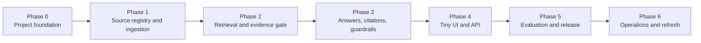
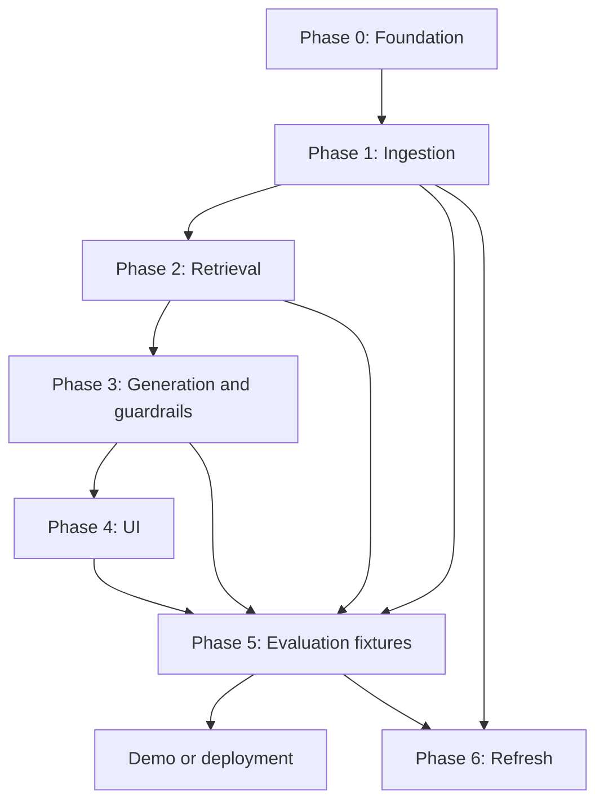

# Phased Implementation Plan: ICICI Prudential Facts-Only RAG Assistant

This plan implements the system described in [architecture.md](architecture.md) and the project requirements in [problemStatement.md](problemStatement.md). The goal is a demonstrable facts-only assistant grounded in the 15 approved ICICI Prudential AMC documents.

## Delivery Path

## Phase 0 — Project Foundation

### Objective

Create a reproducible local project structure and establish the policy constraints before adding sources or models.

### Work

- Choose the frontend, backend, document extractor, and vector index; the model choices are fixed as **Gemini** for answer generation and **BGE** for embeddings.
- Create environment-based configuration for Gemini credentials, the BGE model identifier, source directories, index locations, and environment mode.
- Create separate locations for raw source documents, extracted text, indexes, tests, and application logs.
- Define the domain allowlist: ICICI Prudential AMC is approved; Groww is explicitly blocked from ingestion and citations.
- Add a privacy policy module that detects likely PAN, Aadhaar, account number, OTP, email, and phone-number input.
- Add basic project documentation with local setup and commands.

### Deliverables

- Runnable backend skeleton with `/api/health`.
- Configuration template such as `.env.example`; no secrets in source control.
- Model configuration documenting Gemini as the LLM and the selected BGE variant as the embedding model.
- Initial README with prerequisites and local run instructions.
- Source allowlist and blocked-domain configuration.

### Exit Criteria

- The health endpoint reports application and configuration status.
- A Groww URL is rejected by the allowlist check.
- Credentials are loaded only from environment configuration.

## Phase 1 — Source Registry and Document Ingestion

### Objective

Build the approved corpus from the five selected schemes and preserve provenance for every retrieved fact.

### Implementation Sequence

Implement and validate these subphases in order. A subphase should not be started until the preceding checkpoint passes.

#### Phase 1.1 — Registry Schema and Scheme Catalogue

**Goal:** Create the source-of-truth metadata structure before downloading anything.

- Choose a versioned JSON or SQLite registry; use it consistently throughout the project.
- Define the registry fields: `source_id`, `scheme_id`, `scheme_name`, `document_type`, `official_url`, `approved_domain`, `published_date`, `retrieved_at`, `content_hash`, and `status`.
- Add the five canonical scheme IDs and their aliases, including `Top 100` for `icici_large_mid_cap`.
- Register exactly 15 official sources: KIM, SID, and factsheet for every supported scheme.
- Keep Groww URLs out of the registry; they may remain only in the planning documentation as reference links.

**Checkpoint:** The registry validates structurally, contains 15 pending official sources, has no duplicate `source_id`, and contains no `groww.in` URL.

#### Phase 1.2 — Safe Downloader and Source Lifecycle

**Goal:** Download only allowlisted sources and retain an auditable record of each attempt.

- Build a downloader that calls the Phase 0 allowlist check before a request and checks the final redirect host after it.
- Store successful downloads only in `data/raw_sources/`; never expose that directory through the API or client.
- Record fetch timestamp, final canonical URL, content type, file size, SHA-256 hash, and lifecycle status (`approved`, `failed`, or `blocked`).
- Reject Groww, lookalike domains, invalid content types, empty files, and failed downloads before extraction.
- Make reruns idempotent: an unchanged URL/hash must not create duplicate source versions.

**Checkpoint:** One official fixture or approved source downloads successfully with complete metadata; Groww and a redirect to Groww are blocked; a corrupt/empty fixture is marked failed with no stored searchable content.

#### Phase 1.3 — Page-Level Text Extraction and OCR Fallback

**Goal:** Produce page-addressable text without yet attempting semantic chunking.

- Extract each downloaded PDF page independently using the chosen extractor (PyMuPDF).
- Persist extracted page records separately in `data/extracted_text/`, retaining `source_id`, page number, and extraction method.
- Run OCR only for pages with no usable native text; label every OCR-derived page and do not automatically approve uncertain numerical/table output.
- Preserve page boundaries exactly and record blank or failed pages for review.

**Checkpoint:** A KIM, SID, and factsheet each produce page-level text records. At least one manually inspected page per type matches the visible source page, and an image-only fixture uses the OCR-marked path.

#### Phase 1.4 — Normalisation and Document Quality Checks

**Goal:** Clean extract output conservatively while detecting sources that are unsafe to index.

- Normalise whitespace, headings, and tables without merging text across pages.
- Validate expected scheme names against each source's `scheme_id`; quarantine mismatches.
- Detect empty pages, invalid/update-date metadata, duplicate content hashes, and missing required registry fields.
- Produce a per-source quality result and reason codes; only passing sources can proceed to chunking.

**Checkpoint:** Quality checks correctly approve a valid fixture and quarantine fixtures with a scheme mismatch, missing metadata, duplicate hash, or unusable extraction.

#### Phase 1.5 — Chunking and Provenance Enrichment

**Goal:** Convert approved page text into retrieval-ready records with complete lineage.

- Split text into roughly 300–500-token chunks with 50–75-token overlap.
- Never create a chunk across document or page boundaries; retain the originating PDF page number.
- Attach `chunk_id`, `source_id`, `scheme_id`, `document_type`, `page_number`, `section_title`, fact tags, and source update date to every chunk.
- Validate every chunk against the registry and reject incomplete or cross-scheme records.

**Checkpoint:** Sample chunks from KIM, SID, and factsheet sources each trace unambiguously to one approved official URL and PDF page; no chunk includes Groww content or metadata.

#### Phase 1.6 — Full-Corpus Ingestion Run and Audit Report

**Goal:** Run the pipeline against the 15 registered documents and make the result inspectable.

- Run registry validation, download, extraction, quality checks, and chunking for all 15 approved documents.
- Write an ingestion report showing source ID, scheme, document type, status, hash, version, page count, chunk count, and any failure/block reason.
- Confirm only current, approved sources are marked ready for Phase 2 indexing; failed, blocked, superseded, and quarantined items remain excluded.
- Manually verify representative fee, SIP, benchmark, exit-load, or riskometer facts in one KIM, one SID, and one factsheet against their cited pages.

**Checkpoint / Phase 1 exit criteria:** Exactly 15 approved official documents are ready for indexing; no Groww URL, content, or chunk exists in application data; every chunk has source-URL and page provenance; and the manual document-type checks pass.

### Phase 1 Deliverables

- Versioned source registry and scheme alias catalogue.
- Private local copies of successfully ingested official documents.
- Page-level extracted text and provenance-complete chunk records.
- Automated quality-check results and an ingestion report showing approved, failed, blocked, and quarantined sources.

## Phase 2 — Hybrid Retrieval and Evidence Confidence

### Objective

Retrieve the correct official evidence for a factual question and decline to answer when evidence is insufficient.

### Work

- Generate BGE embeddings for all approved chunks and store them in the selected vector index.
- Build keyword/BM25 search for exact finance terms such as “exit load,” “minimum SIP,” “expense ratio,” “benchmark,” and “riskometer.”
- Implement hybrid retrieval with scheme filtering when the question names a supported scheme.
- Implement scheme resolution and the alias table.
- Retrieve 8–12 candidates and rerank them by relevance to the exact requested fact.
- Define an evidence-confidence threshold based on relevance, source metadata completeness, and agreement between query, scheme, and chunk.
- Return a no-verified-answer result when the threshold is not met or sources conflict.

### Deliverables

- Search service returning ranked evidence chunks with source metadata.
- Scheme-resolution module and alias test cases.
- Confidence-gate implementation with a structured `verified` or `unverified` result.

### Exit Criteria

- Factual test questions retrieve chunks from the intended scheme and document.
- “Top 100” resolves to ICICI Prudential Large & Mid Cap Fund.
- Out-of-scope scheme questions return no evidence rather than a cross-scheme answer.
- Low-confidence queries do not proceed to answer generation.

## Phase 3 — Facts-Only Answers, Citations, and Guardrails

### Objective

Generate concise answers grounded only in verified evidence and safely handle prohibited requests.

### Work

- Write the model system prompt and response contract: factual claims only, a maximum of three sentences, no investment advice, and no unstated knowledge.
- Pass Gemini only the user question and selected approved evidence snippets with source IDs.
- Build a citation formatter that derives the displayed link and source date from the source registry, never from model-generated URL text.
- Validate the generated answer for sentence count, citation presence, citation approval status, advice language, unsupported numerical claims, and performance comparisons.
- Implement policy paths for PII, investment advice, performance/return comparisons, unsupported schemes, and unclear scheme references.
- Add a one-time regeneration path for invalid output; return a safe unable-to-verify response if it still fails.

### Deliverables

- `POST /api/chat` service returning a structured response: answer, response type, source title, official URL, source date, and disclaimer.
- Gemini generation adapter and BGE query-embedding adapter, both invoked only by the backend.
- Citation and policy validation layer.
- Refusal templates for advice, PII, and performance-comparison requests.

### Exit Criteria

- Every factual answer includes a valid official source URL.
- The backend rejects any citation URL not present in the approved registry.
- Advice requests are refused without a recommendation.
- PII-containing input is not persisted in logs and does not reach retrieval or the model.
- Performance requests do not calculate, rank, or compare returns.

## Phase 4 — Minimal UI and API Integration

### Objective

Deliver a clear, small interface that makes grounded answers and safety limits visible.

### Work

- Build a single-page interface with a welcome message, one input, submit action, answer area, and loading/error states.
- Add three example factual questions that are covered by the initial corpus.
- Render the official source link and “Last updated from sources” value from validated API fields.
- Display the persistent disclaimer: “Facts-only. No investment advice.”
- Add distinct visual states for refusal, no verified answer, and normal factual answer.
- Add client-side input limits and do not store chat histories in the browser by default.

### Deliverables

- Functional local UI connected to `/api/chat`.
- Responsive answer, citation, disclaimer, and failure states.
- Short screen-recording-ready demo flow.

### Exit Criteria

- A user can ask a factual question and open the cited official URL.
- The UI does not offer upload, account lookup, or personal-information fields.
- Refusals remain understandable and include an official education/factsheet link where applicable.

## Phase 5 — Evaluation, Documentation, and Release Readiness

### Objective

Prove that the prototype meets its facts-only, citation, and safety requirements before demonstration or deployment.

### Work

- Create 5–10 representative evaluation cases, including expense ratio, exit load, SIP minimum, benchmark/riskometer, document navigation, advice refusal, performance refusal, PII refusal, and unsupported-scheme handling.
- For each case, record the expected route, scheme, source, response characteristics, and pass/fail result.
- Manually verify every cited claim against the cited page or source section.
- Test source-link rendering, long questions, ambiguous scheme names, unavailable documents, and model/API failures.
- Create the required sample Q&A file with answers and official links.
- Update README with setup, scope, corpus details, known limitations, and disclaimer text.
- Create the submitted source-list file from the approved registry.

### Deliverables

- Evaluation report and test fixtures.
- Sample Q&A file containing 5–10 tested interactions.
- Source-list CSV or Markdown file.
- Complete README and final UI disclaimer.
- Hosted prototype link or a demo video no longer than three minutes.

### Exit Criteria

- Every factual evaluation answer is grounded in the correct official source.
- No evaluation case produces investment advice, return comparison, or PII persistence.
- All required submission artifacts are present and internally consistent.

## Phase 6 — Source Refresh and Operational Maintenance

### Objective

Keep the factual corpus current and make failures auditable after the prototype is released.

### Work

- Schedule or document a monthly factsheet refresh and quarterly KIM/SID refresh.
- Compare hashes, retain previous versions, and index only the latest approved version.
- Track ingestion failures, source freshness, retrieval confidence, citation-validation failures, and no-answer rates.
- Review recurring no-answer queries to identify missing official source material.
- Re-run the evaluation set after any source, prompt, retrieval, or model change.

### Deliverables

- Repeatable refresh command or protected admin endpoint.
- Source freshness report.
- Lightweight operational checklist and change log.

### Exit Criteria

- A changed document produces a new source version and re-indexed chunks.
- Superseded content is excluded from default retrieval.
- The evaluation suite passes after a refresh.

## Dependency Map

## Recommended Build Order for an MVP

For the fastest working prototype, complete these minimum slices in order:

1. Source registry and ingestion for one scheme plus its KIM, SID, and factsheet.
2. Scheme-filtered retrieval and a no-answer confidence path.
3. Factual answer generation with registry-backed citations.
4. Advice, performance, and PII refusals.
5. Minimal UI with three examples and the required disclaimer.
6. Expand ingestion to the remaining four schemes and run the full evaluation set.

This prevents UI work from masking gaps in corpus provenance, retrieval quality, or policy enforcement.
